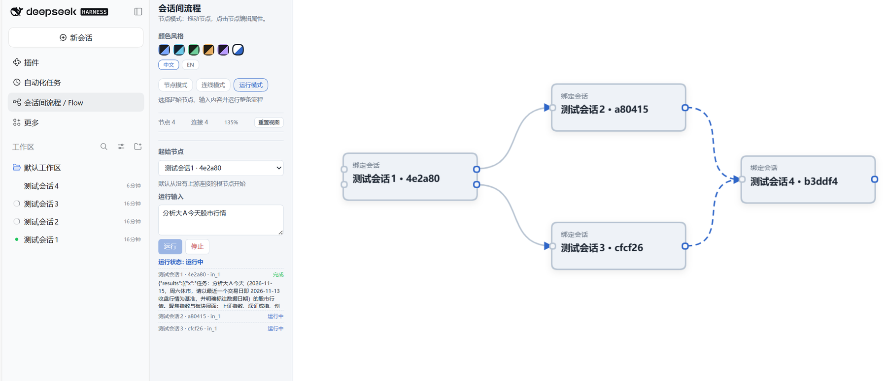
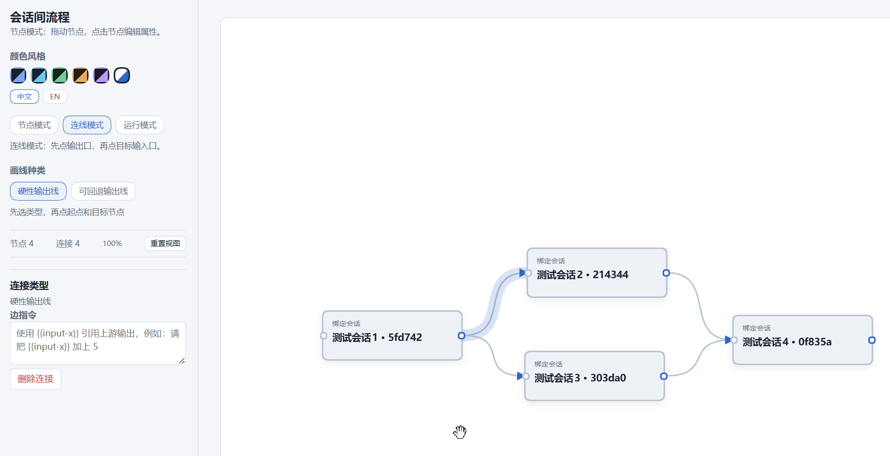
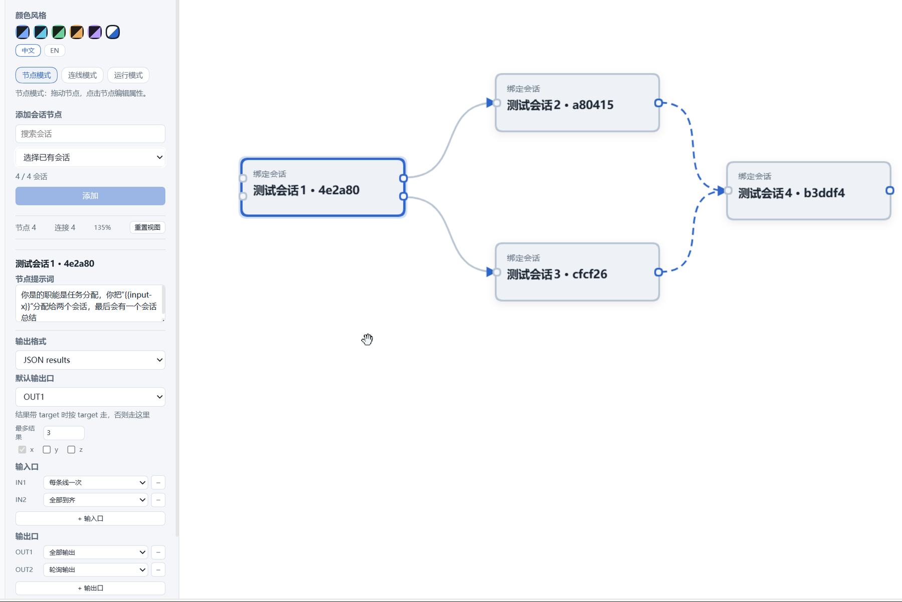
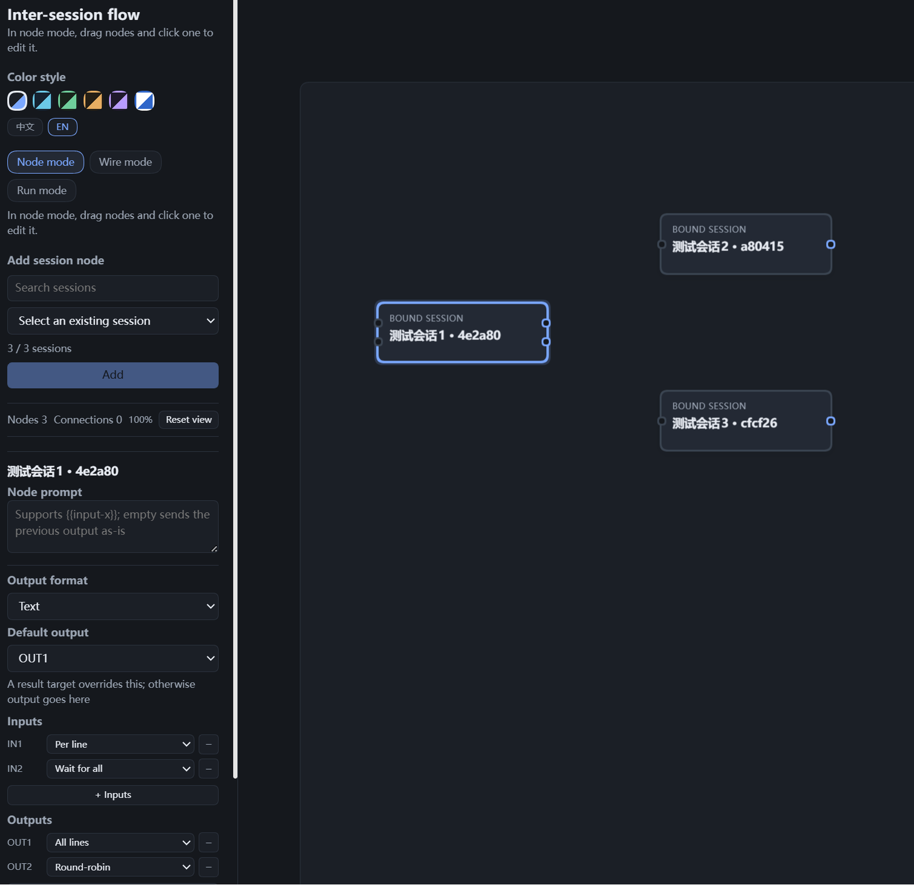

# 会话间流程 / Inter-session Flow

把多个已有的 DSH 会话组织成一条真正会执行的工作流：会话之间自动交接任务、并行处理、汇总结果。

| 项 | 值 |
| --- | --- |
| 版本 | `1.0.2` |
| 形态 | DSH 插件 bundle（Host + Client） |
| 平台 | DSH Web / Desktop |
| 数据 | `%DSH_HOME%/inter-session-flow/` |
| 许可 | MIT |

---

## 面向问题

一个会话同时做资料搜集、写作、审查和汇总，迟早会角色漂移、上下文膨胀、输出互相污染。把工作拆到多个专用会话是自然做法，但拆开之后，交接靠人复制粘贴，效率低下。

会话间流程解决的就是这一点：**会话之间的交接，只要像流程图一样设计好一个流程产线，一句话就可以完成整个复杂任务**。

```text
研究 → 写作 → 审查 → 汇总
```

每个会话保持专一，交接由引擎完成，结果按规则流向下一站。

---

## 插件简介

- 这是一个**跨会话执行图**：节点绑定已有会话，端口和连线定义交接；
- 支持**输入口策略** `each` / `all`，**输出口策略** `all` / `roundRobin`；
- 支持**边指令**、**节点提示词**、**文本 / JSON 输出契约**；
- 支持**并行分支**、失败隔离、运行停止与运行日志；
- 中英文界面、6 套局部配色。

## 插件界限

- 不可循环连接；
- 不创建、不复制会话，只复用已有顶层会话；
- 不替代 DSH 的会话权限系统，也不提升目标会话权限。

---

## 核心能力

### 1. 会话保持专一

每个节点只负责自己的职责与上下文。研究、写作、审查、汇总各用一个会话，互不污染。

### 2. 分支可以并行

一个输出口可以连多条下游边，引擎并行启动不同节点的任务；同一节点内部仍串行，避免同一会话被并发写入。

```text
        ┌→ 章节 A
大纲 ───┼→ 章节 B
        └→ 章节 C
```

三条分支同时跑，最后一个汇总节点收齐。

### 3. 交接是有契约的

- **边指令**：写在连线上，例如 `请把 {{input-x}} 加上 5`；
- **节点提示词**：写在节点上，例如 `你是计算器，只返回 JSON results`；
- **输出契约**：文本，或 JSON `results` 数组，结果可带 `target` 指定输出口。

交接不再是复制一段自然语言，而是结构化任务输入。

### 4. 多结果可分流

```json
{
  "results": [
    { "x": "结果1", "target": "out_1" },
    { "x": "结果2", "target": "out_2" },
    { "x": "结果3" }
  ]
}
```

带 `target` 的结果走指定输出口，没有 `target` 的走默认输出口；输出口策略只作用于被选中的口，不会向所有端口广播。

### 5. 多上游可汇合

输入口设为 `all` 时，该口连接的所有硬性输入线到齐后合并执行一次。适合“三个章节都写完再汇总”。

### 6. 运行过程可观察

运行面板逐节点显示状态（运行中 / 完成 / 错误 / 已停止），运行日志记录投递、执行、失败与重试，可以回看每一步。

### 7. 不提升权限

任务通过 `agent-message` / `relay` 投递给目标会话，目标会话看到的是外部任务消息，不是用户输入；插件不会提升或绕过目标会话的权限。

---

## 界面









---

## 快速开始

### 1. 安装

在 DSH 的插件管理中安装本 bundle（或使用 `plugin_manager` 安装本地包目录），安装后刷新页面。

侧栏出现「会话间流程」入口即安装成功。

### 2. 添加节点

进入**节点模式**，从左侧「选择已有会话」里添加节点。归档会话、子会话、Subagent 会话与空会话不会出现在列表里。

### 3. 配置节点

选中节点，设置：

- 节点提示词；
- 输出格式（文本 / JSON results）；
- 默认输出口；
- 输入口策略（`each` / `all`）；
- 输出口策略（`all` / `roundRobin`）；
- 端口数量（最多 3 进 / 3 出）。

### 4. 连线

进入**连线模式**：

1. 选择「硬性输出线」或「可回退输出线」；
2. 点击起始节点的输出口；
3. 点击目标节点的输入口；
4. 选中连线，填写边指令。

### 5. 运行

进入**运行模式**：

1. 选择起始节点（默认从没有上游的根节点开始）；
2. 填写运行输入；
3. 点击「运行」；
4. 在运行面板查看每个节点的状态与结果。

---

## 概念模型

```text
Graph
  Node   绑定一个已有会话
    InputPort   接收上游输出
    OutputPort  发送本节点输出
  Edge   从一个输出口连到一个输入口
```

| 概念 | 说明 |
| --- | --- |
| 节点模式 | 拖动节点、编辑属性 |
| 连线模式 | 选口、连线、写边指令 |
| 运行模式 | 选起点、填输入、运行与查看状态 |

### 输入口

| 策略 | 行为 |
| --- | --- |
| `each` | 每条输入线到达时执行一次 |
| `all` | 所有已连接的硬性输入线到齐后合并执行一次 |

### 输出口

| 策略 | 行为 |
| --- | --- |
| `all` | 该口连接的每条线都收到结果 |
| `roundRobin` | 多个结果按连线顺序轮询分发 |

```text
OUT1 → A (order 0)
OUT1 → B (order 1)
OUT1 → C (order 2)

结果1 → A    结果2 → B    结果3 → C    结果4 → A
```

### 输出契约

文本模式：

```json
{ "output": "任意文本" }
```

JSON 模式：

```json
{
  "results": [
    { "x": "…", "target": "out_1" },
    { "x": "…", "target": "out_2" }
  ]
}
```

- 每个结果可带 `target`，定向到指定输出口；不带时走默认输出口；
- 字段可用 `x` / `y`，在边指令中分别用 `{{input-x}}` / `{{input-y}}` 引用。

JSON 解析失败会自动重试一次；仍失败则记为节点错误，不影响其他分支。

---

## 执行模型

- **起始节点**：默认从没有上游连线的根节点开始，也可手动指定；
- **并行**：不同节点的任务并行执行，同一节点串行；
- **失败隔离**：某个分支失败不会终止其他分支；
- **停止**：运行中可停止，正在执行的任务会收到停止信号，节点落为 `stopped`，不会残留 `running`；
- **上限**：并行任务最多 8 个。

---

## 数据与 API

### 数据

```text
%DSH_HOME%/inter-session-flow/graph.json     流程定义
%DSH_HOME%/inter-session-flow/runs/<id>.json 运行记录
```

### HTTP API

```text
GET  /api/inter-session-flow/graph
POST /api/inter-session-flow/graph
GET  /api/inter-session-flow/sessions
GET  /api/inter-session-flow/run
POST /api/inter-session-flow/run
POST /api/inter-session-flow/run/stop
```

运行请求：

```json
{
  "graph": { "nodes": [], "edges": [] },
  "input": "计算 1+1，只回复数字",
  "startNodeId": "n_xxx"
}
```

---

## 兼容性

- 需要支持插件 bundle 的 DSH Web / Desktop；
- 依赖 DSH 的 `webServer`、`sessionQuery`、`agents`、`sessionController` 服务；
- 可选使用 `sessions`、`sessionTitle`、`workspaceRegistry`，缺失时降级为无标题/无工作区信息；
- 升级时先移除旧 bundle 再安装新目录，刷新页面后生效；`graph.json` 保持兼容。

### 数据兼容

图版本为 `2`：旧节点自动补 `IN1` / `OUT1`，旧边落到默认端口，旧 `oneway` → `hard`、`twoway` → `returnable`。

---

## 已知限制

- 「可回退输出线」目前只有类型与视觉，真实回退执行尚未实现；
- `all` 输入口要求所有已连接硬性线到齐，缺一支会报 `incomplete-join`，没有超时跳过；
- 单节点最多 3 个输入口 / 3 个输出口；
- 单节点最多 10 个结果，字段路由以 `x` 为主；
- 不设自动超时，长任务需要手动停止；
- 并行任务上限 8；
- 暂不包含自动创建会话、自动选择模型或 AI 监管节点。

---

## 故障排查

| 现象 | 检查 |
| --- | --- |
| 侧栏没有入口 | bundle 是否启用；刷新页面；是否有重复面板 key |
| 运行没有触发下游 | 边的方向；结果的 `target` 是否存在；输出口策略；`all` 是否到齐 |
| 节点报格式错误 | 输出是否为 JSON `results`；字段与数量是否超出 `outputSpec`；查看 `format-retry` 日志 |
| 启动失败 | DSH 启动日志；Host / Client 是否都能独立导入；是否有残留旧 bundle |

---

## 许可

MIT，Copyright (c) 2026 dhd (https://github.com/dhd78)。见 `LICENSE`。

---

## English

**Inter-session Flow** organizes existing DSH sessions into a workflow that actually runs: sessions hand tasks to each other, branches execute in parallel, and results are merged by rule.

| Item | Value |
| --- | --- |
| Version | `1.0.2` |
| Form | DSH plugin bundle (Host + Client) |
| Platform | DSH Web / Desktop |
| Data | `%DSH_HOME%/inter-session-flow/` |
| License | MIT |

### The problem it solves

One session doing research, writing, review and summary drifts, bloats and contaminates its own context. Splitting the work across focused sessions is natural — but then the handoffs become copy-paste.

Inter-session Flow removes that step: design the handoff once as a pipeline, then run the whole task with a single instruction.

```text
research → writing → review → summary
```

Each session stays focused; the engine carries the handoff and routes results to the next stage.

### What it is

- an **executable cross-session graph**: nodes bind existing sessions, ports and edges define the handoffs;
- **input strategies** `each` / `all`, **output strategies** `all` / `roundRobin`;
- **edge instructions**, **node prompts**, and **text or JSON output contracts**;
- **parallel branches**, failure isolation, run stop and run logs;
- Chinese / English UI, six local color themes.

### Boundaries

- no cyclic connections;
- it does not create or copy sessions — it reuses existing top-level sessions;
- it does not replace DSH's session permissions and does not elevate them.

### Core capabilities

1. **Focused sessions** — each node owns only its own role and context.
2. **Parallel branches** — one output port can feed several downstream edges; the engine starts independent nodes in parallel, while a single node stays serial to avoid concurrent writes to one session.
3. **Contracted handoffs** — edge instructions, node prompts and an output contract (text, or a JSON `results` array whose entries may carry `target`) replace copy-pasted prose with structured task input.
4. **Result routing** — results with `target` go to that output port; results without one go to the node's default port. The output strategy applies only to the selected port, not to every port.
5. **Joins** — an `all` input port waits for every connected hard edge, then merges and runs once.
6. **Observable runs** — the run panel shows per-node state (running / done / error / stopped), and the run log records delivery, execution, failures and retries.
7. **No privilege elevation** — tasks are delivered through `agent-message` / `relay`; the target session sees an external task message, not user input.

### Quick start

1. Install the bundle from the DSH plugin manager (or install the local package directory with `plugin_manager`), then refresh the page.
2. **Node mode**: add existing sessions from the left panel. Archived, child, subagent and empty sessions are not listed.
3. **Configure**: node prompt, output format (text / JSON results), default output port, input strategy, output strategy, up to 3 input and 3 output ports.
4. **Wire mode**: pick 「硬性输出线」 (hard) or 「可回退输出线」 (returnable), click the source output port, then the target input port; select the edge to edit its instruction.
5. **Run mode**: choose the start node (the root without upstream edges by default), enter the run input, click Run, and watch node states and results.

### Data and API

```text
%DSH_HOME%/inter-session-flow/graph.json       graph definition
%DSH_HOME%/inter-session-flow/runs/<id>.json   run record
```

```text
GET  /api/inter-session-flow/graph
POST /api/inter-session-flow/graph
GET  /api/inter-session-flow/sessions
GET  /api/inter-session-flow/run
POST /api/inter-session-flow/run
POST /api/inter-session-flow/run/stop
```

### Compatibility

- requires a DSH Web / Desktop build that supports plugin bundles;
- depends on the DSH `webServer`, `sessionQuery`, `agents` and `sessionController` services;
- optionally uses `sessions`, `sessionTitle` and `workspaceRegistry`; missing ones degrade to untitled sessions and no workspace info;
- upgrade by removing the old bundle, installing the new directory and refreshing the page; `graph.json` stays compatible.

### Known limits

- returnable output edges exist in the type model and UI only; fallback execution is not implemented;
- `all` input ports require every connected hard edge; a missing one reports `incomplete-join`, with no timeout skip;
- max 3 input / 3 output ports per node;
- max 10 results per node; field routing is `x`-centric;
- no automatic timeout; long tasks must be stopped manually;
- parallel jobs are capped at 8;
- no automatic session creation, model selection or AI supervisor node.

**License**: MIT, Copyright (c) 2026 dhd (https://github.com/dhd78).
